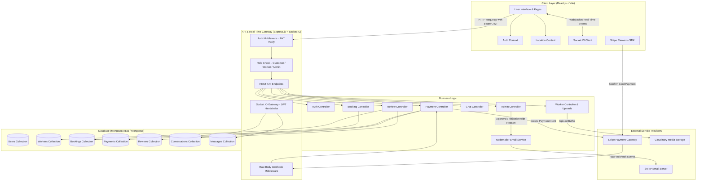

# ServeConnect — Hyper-Local Service Professional Marketplace

> **UCS503P — Software Engineering Project (2026-27 ODD)**  
> **Thapar Institute of Engineering and Technology, Patiala**  
> **Repository:** `UCS503P-2026-27-Local-Hands`  
> **Live Website:** [https://serveconnect-frontend.onrender.com](https://serveconnect-frontend.onrender.com)  
> **Live API:** [https://serveconnect-backend-ucjp.onrender.com/health](https://serveconnect-backend-ucjp.onrender.com/health)

[]()
[]()
[]()
[]()
[]()

---

## 📖 Executive Summary

**ServeConnect** (Local Hands) is an on-demand, hyper-local service marketplace inspired by Urban Company. The platform seamlessly bridges the gap between everyday consumers and verified independent service professionals — including **Plumbers, Electricians, Carpenters, Painters, Cleaners, and AC Technicians**.

Engineered using the **MERN (MongoDB, Express.js, React.js, Node.js) + Socket.IO + Stripe** architecture, ServeConnect incorporates end-to-end user authentication, geo-location filtering, double-booking prevention, an administrative verification engine, automated transactional email dispatching (approvals and rejections with feedback), real-time live chat with room-level data isolation, in-app Stripe card payments with webhook verification, Cloudinary document and image uploads, a 5-star customer review and rating engine, and comprehensive Jest/Supertest automated testing suites.

---

## 👥 Project Team & Core Responsibilities

| Roll No. | Name | Primary Domain | Key Contributions |
| :--- | :--- | :--- | :--- |
| **1024170415** | **Vijay Kiran** | Backend & Database Engineering | REST APIs, Stripe PaymentIntents SDK & Webhooks, Cloudinary Uploads, MongoDB Schemas (`Payment`, `Review`, `Conversation`, `Message`), Live Chat Socket.IO Engine, Booking Concurrency Isolation |
| **1024170233** | **Pratham Goyal** | Team Lead & Admin Architecture | Worker Verification Engine (`pending` ➔ `approved`/`rejected`), Document Inspection Modal, Nodemailer Notification Architecture, Automated Jest/Supertest Test Suites (42 Tests Passing) |
| **1024170318** | **Keshav Goyal** | Frontend UI/UX & Client State | React.js SPA (Vite), Stripe Elements In-App Checkout Modal (`PaymentModal.jsx`), Interactive Customer Rating & Review Dialog (`ReviewModal.jsx`), WCAG 2.2 AA Compliance, Live Chat UI |

---

## 🌟 Comprehensive Feature Catalog

### 1. 🔐 Authentication & Role-Based Access Control (RBAC)
- **Unified Single Login Page:** A single, professional login portal (`/login`) for all users (Admin, Professional, Customer) without separate demo cards.
- **Automatic Role Detection:** Role detection is driven dynamically by verified backend database responses and JWT payloads (`admin` ➔ `/admin`, `worker` ➔ `/bookings`, `customer` ➔ `/`).
- **Granular RBAC Protection:** Explicit privileges for `customer`, `worker`, and `admin` with route-level backend middleware (`authMiddleware.js`) and client guards (`RoleRoute.jsx`).
- **Privilege Escalation Prevention:** Public registration strictly restricts assigned roles to `customer` or `worker`, preventing public users from creating administrative accounts.
- **Stateless JWT Security:** Cryptographic token generation (`jsonwebtoken`) with `Bearer` header validation.
- **Password Hashing:** Salted one-way hashing with `bcryptjs` (10 rounds).
- **Session Hygiene & Remember Me:** Optional credential caching via `localStorage`, password visibility toggles (`Eye`/`EyeOff`), and full session flush on logout.

### 2. 📍 Hyper-Local Discovery & Dynamic Location Context
- **Zomato-Style Global Location Selector:** Context-powered (`LocationContext`) location switching across primary metropolitan hubs (**Patiala, Delhi, Chandigarh, Ludhiana, Mohali**).
- **HTML5 Geolocation & Reverse Geocoding:** Live coordinates translated to human-readable cities via OpenStreetMap / Nominatim integration.
- **Service Filtering & Smart Ranking:** Filter by category, price tier, and real-time availability with rating-weighted ranking.

### 3. 🛡️ Professional Onboarding & Admin Verification Console
- **Multi-Step Worker Registration:** Technicians register category, experience, hourly rate, servicing radius, bio, trade certificates, and contact details.
- **Vetting Pipeline:** Profiles default to `pending` status and remain hidden from public search until reviewed.
- **Administrative Control Panel (`/admin`):**
  - **Newest First Ordering:** Displays incoming applicant registrations sorted by `createdAt: -1`.
  - **Interactive Review Card Modal:** Administrators click any application row to inspect credentials, portfolios, trade certificates, and ID proofs.
  - **Rejection Reason Capture:** Admins can provide custom review feedback when declining an application.
  - **Non-Blocking Fault-Tolerant Dashboard:** Real-time counts (Total, Pending, Approved, Declined) dynamically derive from MongoDB records with graceful background sync.

### 4. 📧 Automated Transactional Email System (Nodemailer)
- **Zero-Cost Production Ready:** Replaced legacy SMS with a robust, automated Email Notification Service (`code/backend/utils/emailService.js`).
- **Branded Approval Emails:** On admin approval, the professional receives an immediate, beautifully styled confirmation email with verified rate card and direct dashboard access links.
- **Official Rejection Emails with Feedback:** When an application is declined, the worker receives an official notification email featuring the administrator's exact feedback reason and re-application guidance.
- **Resilient Fallback Mode:** Operates in graceful simulation logging mode if SMTP credentials (`EMAIL_USER`, `EMAIL_PASS`) are omitted in development, guaranteeing zero-crash operation.

### 5. 📅 Double-Booking Prevention & Booking Lifecycle Engine
- **Concurrency Collision Detection:** Algorithmic verification prevents overlapping time-slot reservations for the same professional.
- **Full State Machine:** Bookings transition transparently across `pending` ➔ `accepted` ➔ `completed` ➔ `paid` (or `rejected`).
- **Bidirectional Dashboards:** 
  - **Customers:** Track booking statuses, view professional details, open live chat, pay via Stripe, leave reviews, and inspect booking cards.
  - **Workers:** Review incoming service requests, accept or reject jobs, coordinate with clients, and mark services as completed.

### 6. 💬 Real-Time Live Chat & Interactive Messaging (Socket.IO)
- **Direct Contextual Communication:** Chat button integrated on booking cards and booking detail modals linking directly to `/chat/:bookingId`.
- **Cryptographic Socket Handshake:** Authenticates every socket connection using JWT via `socket.handshake.auth.token` before connection establishment.
- **Room-Level Data Isolation:** Users only join private booking rooms (`join_room`) if they are the authenticated customer, the assigned service professional, or an admin.
- **Instant Two-Way Messaging:** Socket events (`send_message`, `receive_message`) deliver messages in real time without refreshing the page.
- **Typing Indicators & Live Status:** Animated live typing indicators (`user_typing`, `user_stopped_typing`) and socket connection badges (`Live` vs `Connecting`).
- **Message Grouping & Auto-Scroll:** Chat history grouped by calendar dates (*"Today"*, *"Yesterday"*), with smooth auto-scroll to the newest message.
- **Persistent Storage & REST Fallback:** Messages are persisted to MongoDB (`Message` and `Conversation` models); an HTTP REST fallback (`POST /api/chat/:bookingId/messages`) ensures message delivery even during temporary socket reconnects.

### 7. 💳 In-App Stripe Payments & Security (Week 8)
- **Official Stripe Node.js SDK:** Integrated official `stripe` client with fallback simulation for offline and sandbox environments.
- **Server-Side Trusted Amount Calculation:** Payment amounts are calculated strictly on the server from authoritative database records (never trusting client-supplied values).
- **Payment Lifecycle & Idempotency:** Creates Stripe PaymentIntents with currency conversion (INR paise) and cryptographic idempotency keys preventing duplicate charges.
- **Raw-Body Webhook Verification:** Express middleware configured with raw buffer verification (`req.rawBody`) validating `stripe-signature` headers for `payment_intent.succeeded` and `payment_intent.payment_failed`.
- **Payment State Management:** Seamless booking status transitions (`completed` ➔ `paid`), recording Stripe PaymentIntent IDs, amounts, receipt URLs, and paid timestamps in MongoDB.
- **Stripe Elements React Checkout:** Client-side payment form utilizing `@stripe/stripe-js` and `@stripe/react-stripe-js` with live card validation, loading indicators, cardholder receipts, and error recovery.

### 8. 🛡️ Trust & Verification Architecture (Week 9)
- **Cloudinary Integration:** Cloud-hosted image and PDF document uploads with Multer buffer handling (`5MB` max size, JPEG/PNG/WebP/PDF validation).
- **Worker Verification Lifecycle:** Three distinct states (`pending`, `approved`, `rejected` with admin reason).
- **Acceptance Gate Protection:** Unverified and rejected professionals are strictly blocked from accepting bookings (`updateBookingStatus` returns `403`).
- **Inspection Console:** Admins can view uploaded certificates, trade licenses, and ID records directly within the review drawer before approving.
- **Search Exclusivity:** Public customer search filters exclusively for `status: 'approved'` professionals.

### 9. ⭐ Customer Reviews & Rating Engine (Week 9)
- **Verified Completion Requirement:** Reviews are strictly restricted to customers with `completed` or `paid` bookings.
- **Anti-Duplication Enforcement:** Unique compound index `{ booking: 1 }` guarantees only one review per eligible appointment.
- **Real-Time Dynamic Recalculation:** Submitting or updating a review automatically recalculates the professional's `averageRating` and `totalReviews` in MongoDB.
- **Interactive Review Modal:** 5-star interactive rating component with quick sentiment pills, detailed feedback textarea, and live score sync.

### 10. ♿ WCAG 2.2 AA Accessibility & Interface Standardization
- **Contrast Ratios (Criterion 1.4.3):** Verified high-contrast color pairings across all badges, status pills, and action buttons.
- **Icon Standardization:** Replaced decorative interface emojis with consistent, scalable `lucide-react` icons across navigation, cards, tabs, and alerts.
- **Semantic HTML & Focus Trapping:** Accessible modals, ARIA labels on buttons, and screen-reader accessible heading hierarchies.
- **Zoom Independence:** Removed viewport constraints, ensuring low-vision users can zoom up to 500% freely.

### 11. 🌐 Technical SEO & Indexing Architecture
- **Search Directives:** Custom `robots.txt` allowing public indexation while protecting private user areas (`/admin`, `/bookings`, `/chat`).
- **XML Sitemap:** Dynamic `sitemap.xml` listing core discovery endpoints.
- **Social Graph Metadata:** Integrated Open Graph (`og:image`, `og:title`, `og:description`) and Twitter Card tags in `index.html`.
- **Friendly 404 Routing:** Dedicated `NotFound.jsx` component catching unmapped routes with one-click return to home.

---

## 🏗️ System Architecture & Workflow



---

## 🗄️ Database Schemas & Relations

```mermaid
erDiagram
    USER ||--o| WORKER : "registers as"
    USER ||--o{ BOOKING : "places (customerId)"
    WORKER ||--o{ BOOKING : "assigned to (workerId)"
    BOOKING ||--o| PAYMENT : "settled via (paymentId)"
    USER ||--o{ PAYMENT : "pays (customerId)"
    BOOKING ||--o| CONVERSATION : "has private chat"
    CONVERSATION ||--o{ MESSAGE : "contains"
    USER ||--o{ MESSAGE : "sends (senderId)"
    BOOKING ||--o| REVIEW : "rated on (bookingId)"
    USER ||--o{ REVIEW : "writes (customerId)"
    WORKER ||--o{ REVIEW : "receives (workerId)"

    USER {
        ObjectId _id PK
        string name
        string email UK
        string password
        string phone
        string role "customer | worker | admin"
        date createdAt
    }

    WORKER {
        ObjectId _id PK
        ObjectId userId FK
        string category
        string location
        number charges
        number experience
        string bio
        string status "pending | approved | rejected"
        string verificationStatus "pending | approved | rejected"
        string rejectionReason
        string profileImage
        string profileImagePublicId
        array certificates
        array documents
        number averageRating
        number totalReviews
    }

    BOOKING {
        ObjectId _id PK
        ObjectId customerId FK
        ObjectId workerId FK
        string service
        string date
        string time
        string address
        number estimatedHours
        number estimatedPrice
        string status "pending | accepted | rejected | completed | paid"
        string paymentStatus "unpaid | pending | paid | refunded"
        ObjectId payment FK
    }

    PAYMENT {
        ObjectId _id PK
        ObjectId booking FK
        ObjectId customer FK
        string stripePaymentIntentId UK
        number amount
        string currency
        string status "requires_payment_method | succeeded | failed"
        string paymentMethod
        string receiptUrl
        date paidAt
    }

    REVIEW {
        ObjectId _id PK
        ObjectId booking UK FK
        ObjectId customer FK
        ObjectId worker FK
        number rating "1 to 5"
        string comment
        date createdAt
    }

    CONVERSATION {
        ObjectId _id PK
        ObjectId bookingId FK
        ObjectId customerId FK
        ObjectId workerId FK
        object lastMessage
    }

    MESSAGE {
        ObjectId _id PK
        ObjectId bookingId FK
        ObjectId senderId FK
        string senderName
        string text
        date createdAt
    }
```

---

## 🔌 API Endpoint Reference

### Authentication (`/api/auth`)
| Method | Endpoint | Access | Description |
| :--- | :--- | :--- | :--- |
| `POST` | `/api/auth/register` | Public | Register new user account (`customer` or `worker`) |
| `POST` | `/api/auth/login` | Public | Authenticate credentials and receive stateless JWT token |

### Workers & Marketplace (`/api/workers`)
| Method | Endpoint | Access | Description |
| :--- | :--- | :--- | :--- |
| `GET` | `/api/workers` | Public | Search approved workers filtered by category, location, and rating |
| `GET` | `/api/workers/:id` | Public | Retrieve verified worker profile, portfolio, and customer reviews |
| `POST` | `/api/workers/register` | Authenticated | Submit worker registration details (creates `pending` profile) |
| `POST` | `/api/workers/upload-profile-image` | Worker | Upload profile picture to Cloudinary |
| `POST` | `/api/workers/upload-document` | Worker | Upload trade certificate or ID proof to Cloudinary |

### Bookings (`/api/bookings`)
| Method | Endpoint | Access | Description |
| :--- | :--- | :--- | :--- |
| `POST` | `/api/bookings` | Customer | Create appointment with concurrency collision check |
| `GET` | `/api/bookings/my-bookings`| Authenticated | Retrieve bookings for current customer or assigned worker |
| `PUT` | `/api/bookings/:id/status`| Authenticated | Update status (`accepted`, `rejected`, `completed`, `paid`) |

### In-App Stripe Payments (`/api/payments`)
| Method | Endpoint | Access | Description |
| :--- | :--- | :--- | :--- |
| `POST` | `/api/payments/create-payment-intent` | Customer | Initiate Stripe PaymentIntent with server-side pricing |
| `POST` | `/api/payments/webhook` | Stripe System | Handle signed webhook events (`payment_intent.succeeded/failed`) |
| `GET` | `/api/payments/booking/:bookingId` | Participants / Admin | Retrieve payment receipt and status for a specific booking |
| `GET` | `/api/payments/:paymentId` | Authorized Users | Retrieve payment transaction details by record ID |

### Customer Reviews & Ratings (`/api/reviews`)
| Method | Endpoint | Access | Description |
| :--- | :--- | :--- | :--- |
| `POST` | `/api/reviews` | Customer | Submit 1–5 star rating & feedback for completed booking (1 review/booking) |
| `GET` | `/api/reviews/worker/:workerId` | Public | Retrieve verified customer reviews and aggregate rating for a worker |
| `PUT` | `/api/reviews/:reviewId` | Review Author | Update rating or comment for an existing review |
| `DELETE` | `/api/reviews/:reviewId` | Author / Admin | Delete review and trigger worker average rating recalculation |

### Real-Time Live Chat (`/api/chat`)
| Method | Endpoint | Access | Description |
| :--- | :--- | :--- | :--- |
| `GET` | `/api/chat/:bookingId` | Booking Participants | Retrieve conversation bundle (booking context, participants, message history) |
| `GET` | `/api/chat/:bookingId/messages` | Booking Participants | Retrieve full message history array for a booking |
| `POST` | `/api/chat/:bookingId/messages` | Booking Participants | REST fallback to post a message when Socket is offline |

### Administration (`/api/admin`)
| Method | Endpoint | Access | Description |
| :--- | :--- | :--- | :--- |
| `GET` | `/api/admin/workers` | Admin | Retrieve worker applications (sorted newest first, filterable) |
| `GET` | `/api/admin/workers/:id` | Admin | Retrieve full applicant inspection card (credentials, portfolio, ID) |
| `PUT` | `/api/admin/workers/:id/approve` | Admin | Approve worker profile and dispatch automated approval email |
| `PUT` | `/api/admin/workers/:id/reject` | Admin | Reject worker profile and dispatch rejection email with admin reason |
| `GET` | `/api/admin/stats` | Admin | Retrieve platform counts (total, pending, approved, declined) |

---

## 📁 Repository Directory Structure

```text
UCS503P-2026-27-Local-Hands/
├── code/
│   ├── backend/                        # Express.js REST API + Socket.IO Server
│   │   ├── config/                     # Database, Stripe, and Cloudinary configurations
│   │   │   ├── cloudinary.js           # Cloudinary SDK client & fallback simulation
│   │   │   ├── db.js                   # MongoDB connection engine
│   │   │   └── stripe.js               # Stripe SDK client & webhook constructor
│   │   ├── controllers/                # Business logic controllers
│   │   │   ├── adminController.js      # Worker approval/rejection & email triggers
│   │   │   ├── authController.js       # Register, login, token creation
│   │   │   ├── bookingController.js    # Data-isolated booking & collision engine
│   │   │   ├── chatController.js       # Conversation initialization & message history
│   │   │   ├── paymentController.js    # Stripe PaymentIntents, webhooks, receipts
│   │   │   ├── reviewController.js     # 5-star reviews & rating recalculation
│   │   │   └── workerController.js     # Search, filter, Cloudinary uploads
│   │   ├── middleware/                 # Auth verification (JWT), roles, and file uploads
│   │   │   ├── authMiddleware.js       # Protect and authorize middleware
│   │   │   └── uploadMiddleware.js     # Multer 5MB file & mimetype guard
│   │   ├── models/                     # Mongoose Schemas (User, Worker, Booking, Payment, Review, Chat)
│   │   ├── routes/                     # Express route declarations
│   │   ├── tests/                      # Automated Jest & Supertest suites (42 Tests)
│   │   │   ├── auth.test.js            # Registration, login, JWT, RBAC guards
│   │   │   ├── booking.test.js         # Booking creation, collision, retrieval
│   │   │   ├── payment.test.js         # PaymentIntents, webhooks, idempotency
│   │   │   ├── review.test.js          # Rating validation, 1-review rule, recalculation
│   │   │   ├── search.test.js          # Approved worker filtering & rating ranking
│   │   │   └── workerVerification.test.js # Verification lifecycle, Cloudinary uploads
│   │   ├── utils/                      # Helper utilities (Nodemailer email service)
│   │   ├── createAdmin.js              # One-click admin generation script
│   │   ├── seed.js                     # 20 workers database seeding script
│   │   └── server.js                   # Application entry point & Socket.IO server
│   │
│   └── frontend/                       # React.js SPA (Vite)
│       ├── public/
│       │   ├── robots.txt              # Search engine crawling directives
│       │   └── sitemap.xml             # XML discovery sitemap
│       ├── src/
│       │   ├── components/             # Reusable UI components & modals
│       │   │   ├── AdminWorkerReviewModal.jsx # Full-screen worker inspection drawer
│       │   │   ├── BookingDetailsModal.jsx    # Booking details & chat trigger modal
│       │   │   ├── PaymentModal.jsx           # Stripe Elements checkout & receipts
│       │   │   ├── ReviewModal.jsx            # 5-star customer review modal
│       │   │   ├── WorkerProfileModal.jsx     # Profile preview & dynamic reviews
│       │   │   ├── Navbar.jsx & Footer.jsx    # Accessible navigation & footer
│       │   │   ├── ProtectedRoute.jsx         # Client-side JWT protection
│       │   │   ├── RoleRoute.jsx              # RBAC route restriction
│       │   │   └── icons.jsx                  # Standardized Lucide-React icon registry
│       │   ├── context/                # AuthContext & LocationContext
│       │   ├── pages/                  # Home, Search, Bookings, Chat, Admin, Login, Register
│       │   ├── services/               # API clients (paymentService, reviewService, etc.)
│       │   ├── App.jsx                 # Route declarations
│       │   └── main.jsx                # Application root render
│       └── index.html                  # Accessible viewport & SEO OpenGraph tags
│
├── .env.example                        # Template environment variables
├── docs/                               # Architecture blueprints & project specifications
├── journals/                           # Sprint journals (Weeks 1 through 7)
└── README.md                           # Master Project Documentation
```

---

## 🚀 Quickstart & Setup Guide

### 1. Prerequisites
- **Node.js**: v18.0.0 or higher
- **MongoDB**: Local MongoDB instance or MongoDB Atlas connection URI
- **Git**

### 2. Backend Installation & Setup

```bash
# Navigate to backend directory
cd code/backend

# Install dependencies
npm install

# Configure Environment Variables (.env)
PORT=5000
MONGO_URI=mongodb+srv://<username>:<password>@cluster.mongodb.net/serveconnect?retryWrites=true&w=majority
JWT_SECRET=serveconnect_super_secret_jwt_key_2026
CLIENT_URL=http://localhost:5173

# Stripe Payment Gateway (Week 8)
STRIPE_SECRET_KEY=sk_test_placeholder_key
STRIPE_WEBHOOK_SECRET=whsec_placeholder_key

# Cloudinary Integration (Week 9)
CLOUDINARY_CLOUD_NAME=your_cloud_name
CLOUDINARY_API_KEY=your_api_key
CLOUDINARY_API_SECRET=your_api_secret

# Email Service
EMAIL_SERVICE=gmail                    # Optional (simulated console fallback if omitted)
EMAIL_USER=your-email@gmail.com        # Optional
EMAIL_PASS=your-app-password           # Optional
EMAIL_FROM="ServeConnect Support <your-email@gmail.com>"

# Seed Database with 20 Verified Professionals
node seed.js

# Initialize / Seed Administrator Account (admin@serveconnect.com / admin123)
npm run seed:admin
# or: node scripts/seedAdmin.js

# Start Backend Server
npm start
```
*Backend runs on: `http://localhost:5000`*

### 3. Frontend Installation & Setup

```bash
# Navigate to frontend directory
cd code/frontend

# Install dependencies
npm install

# Start Vite Development Server
npm run dev
```
*Frontend runs on: `http://localhost:5173`*

---

## 🔑 Default Test Credentials & Unified Login

ServeConnect features a **single unified login page (`/login`) for all roles**. The system automatically detects whether the user is an **Admin**, **Worker**, or **Customer** from the authenticated database response and routes them to their dedicated console without separate login cards or hardcoded frontend role bypasses.

### Test Accounts Table

| Role | Email | Password | Landing Route | Intended Test Workflow |
| :--- | :--- | :--- | :--- | :--- |
| **Admin** | `admin@serveconnect.com` | `admin123` | `/admin` | Access the Admin Console to review pending technician applications, inspect Cloudinary-uploaded certificates and ID documents, approve professionals (triggers approval email) or decline applications (captures rejection reason and sends email). |
| **Professional (Worker)** | `rajesh.kumar@example.com` | `123456` | `/bookings` | Access the Partner Job Manager dashboard to review incoming appointments, accept/decline customer jobs, engage in real-time Socket.IO chat, and mark jobs as completed. |
| **Customer (Vijay)** | `vijayakiranyarra@gmail.com` | `123456` | `/` | Search approved professionals, filter by category and rating, book appointments, open live chat on `/bookings`, pay completed bookings via Stripe, and submit 5-star verified reviews. |
| **Customer (Keshav)** | `keshav@example.com` | `123456` | `/` | Book appointments with separate professionals, verify booking privacy and data isolation on `/bookings`. |

> **Note on Admin Provisioning:**
> To initialize or re-seed the default administrator account in MongoDB Atlas, run:
> ```bash
> cd code/backend
> npm run seed:admin
> ```
> This executes `scripts/seedAdmin.js`, which securely creates/updates `admin@serveconnect.com` with bcrypt-hashed `admin123` (10 rounds) and `role: "admin"`.

---

## 🧪 Automated Testing & Verification

Run the comprehensive Jest integration test suite:

```bash
cd code/backend
npm test
```

### Test Suite Execution Results:
```text
Test Suites: 7 passed, 7 total
Tests:       65 passed, 65 total
Snapshots:   0 total
Time:        59.177 s
```

Coverage breakdown across all 7 test suites:
1. `tests/loginRoleDetection.test.js` (10 tests): Unified login for Admin (`admin@serveconnect.com` / `admin123`), Worker, and Customer; automatic role detection; RBAC route guard enforcement (403 for non-admins); and public admin registration prevention.
2. `tests/auth.test.js` (13 tests): Registration, duplicate user handling, password hashing and comparison, JWT issuance, and RBAC middleware.
3. `tests/booking.test.js` (8 tests): Booking creation, double-booking prevention, worker booking retrieval, and acceptance.
4. `tests/payment.test.js` (9 tests): Stripe PaymentIntent creation, server-side amount calculation, client-side amount tampering prevention, duplicate payment checks, webhook signature verification, `payment_intent.succeeded` & `payment_intent.payment_failed` handlers, and booking authorization.
5. `tests/review.test.js` (7 tests): Review submission, rating range (1-5) validation, one review per booking rule, completed booking eligibility check, and worker average rating recalculation.
6. `tests/workerVerification.test.js` (8 tests): Unapproved worker booking acceptance block, Cloudinary image and document uploads, admin approval/rejection lifecycle with reason tracking.
7. `tests/search.test.js` (10 tests): Approved worker exclusivity in customer search, category filtering, and descending rating ranking.

---

## 📜 Academic Integrity & Coursework Context

Developed for **UCS503P (Software Engineering Project)**, Department of Computer Science & Engineering, **Thapar Institute of Engineering and Technology (TIET)**, Patiala.
