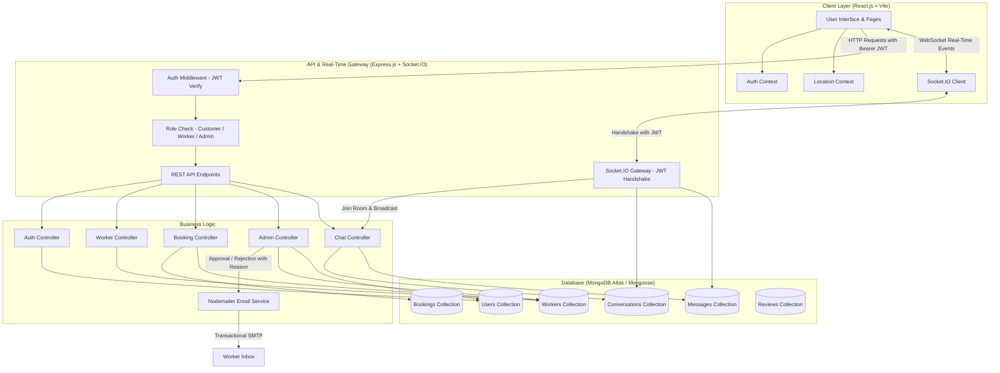
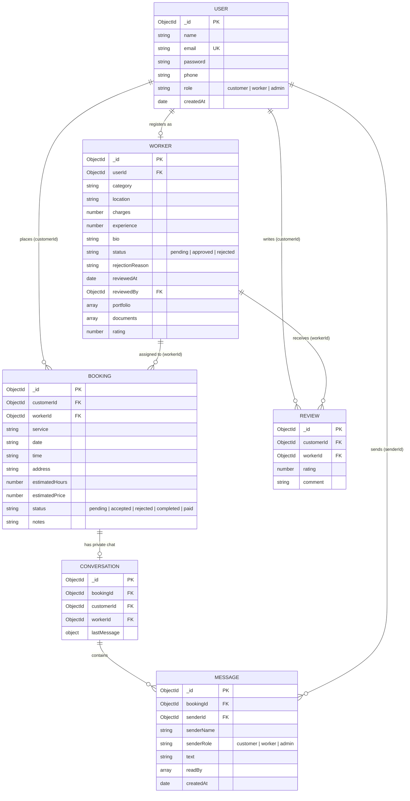

# ServeConnect — Hyper-Local Service Professional Marketplace

> **UCS503P — Software Engineering Project (2026-27 ODD)**  
> **Thapar Institute of Engineering and Technology, Patiala**  
> **Repository:** `UCS503P-2026-27-Local-Hands`

[]()
[]()
[]()
[]()

---

## 📖 Executive Summary

**ServeConnect** (Local Hands) is an on-demand, hyper-local service marketplace inspired by Urban Company. The platform seamlessly bridges the gap between everyday consumers and verified independent service professionals — including **Plumbers, Electricians, Carpenters, Painters, Cleaners, and AC Technicians**.

Engineered using the **MERN (MongoDB, Express.js, React.js, Node.js) + Socket.IO** architecture, ServeConnect incorporates end-to-end user authentication, geo-location filtering, double-booking prevention, an administrative verification engine, automated transactional email dispatching (approvals and rejections with feedback), real-time live chat with room-level data isolation, and full compliance with **WCAG 2.2 AA accessibility** and **Technical SEO** standards.

---

## 👥 Project Team & Core Responsibilities

| Roll No. | Name | Primary Domain | Key Contributions |
| :--- | :--- | :--- | :--- |
| **1024170415** | **Vijay Kiran** | Backend & Database Engineering | REST APIs, Socket.IO server engine, MongoDB Schemas (`Conversation`, `Message`), Booking Data Isolation & Security Hardening, Double-Booking Collision Prevention Engine |
| **1024170233** | **Pratham Goyal** | Team Lead & Admin Architecture | Admin Verification Pipeline (inspection drawer, newest sorting), Automated Notification Architecture (Nodemailer Approval & Rejection Emails), Jest/Supertest E2E & Integration Suites |
| **1024170318** | **Keshav Goyal** | Frontend UI/UX & Client State | React.js SPA (Vite), Real-time Live Chat (`Chat.jsx`), Zomato-Style Location Context, Bookings Dashboard, WCAG 2.2 AA Compliance, Icon Standardizations |

---

## 🌟 Comprehensive Feature Catalog

### 1. 🔐 Authentication & Role-Based Access Control (RBAC)
- **Granular Roles:** Explicit privileges for `customer`, `worker`, and `admin`.
- **Stateless JWT Security:** Cryptographic token generation (`jsonwebtoken`) with `Bearer` header validation via backend middleware (`authMiddleware.js`).
- **Password Hashing:** Salted one-way hashing with `bcryptjs`.
- **Session Hygiene:** Registration workflows automatically flush legacy tokens and user states to eliminate cross-session data leakage.
- **One-Click Demo Authentication:** Pre-filled login helpers for rapid evaluation of Admin, Customer, and Professional roles.

### 2. 📍 Hyper-Local Discovery & Dynamic Location Context
- **Zomato-Style Global Location Selector:** Context-powered (`LocationContext`) location switching across primary metropolitan hubs (**Patiala, Delhi, Chandigarh, Ludhiana, Mohali**).
- **HTML5 Geolocation & Reverse Geocoding:** Live coordinates translated to human-readable cities via OpenStreetMap / Nominatim integration.
- **Service Filtering & Smart Ranking:** Filter by category, price tier, and real-time availability with rating-weighted ranking.

### 3. 🛡️ Professional Onboarding & Admin Verification Console
- **Multi-Step Worker Registration:** Technicians register category, experience, hourly rate, servicing radius, bio, trade certificates, and contact details.
- **Vetting Pipeline:** Profiles default to `pending` status and remain hidden from public search until reviewed.
- **Administrative Control Panel (`/admin`):**
  - **Newest First Ordering:** Displays incoming applicant registrations sorted by `createdAt: -1`.
  - **Interactive Review Card Modal:** Administrators click any application row to inspect credentials, portfolios, trade certificates, and ID proofs.
  - **Rejection Reason Capture:** Admins can provide custom review feedback when declining an application.
  - **Non-Blocking Fault-Tolerant Dashboard:** Real-time counts (Total, Pending, Approved, Declined) dynamically derive from MongoDB records with graceful background sync.

### 4. 📧 Automated Transactional Email System (Nodemailer)
- **Zero-Cost Production Ready:** Replaced legacy SMS with a robust, automated Email Notification Service (`code/backend/utils/emailService.js`).
- **Branded Approval Emails:** On admin approval, the professional receives an immediate, beautifully styled confirmation email with verified rate card and direct dashboard access links.
- **Official Rejection Emails with Feedback:** When an application is declined, the worker receives an official notification email featuring the administrator's exact feedback reason and re-application guidance.
- **Resilient Fallback Mode:** Operates in graceful simulation logging mode if SMTP credentials (`EMAIL_USER`, `EMAIL_PASS`) are omitted in development, guaranteeing zero-crash operation.

### 5. 📅 Double-Booking Prevention & Booking Lifecycle Engine
- **Concurrency Collision Detection:** Algorithmic verification prevents overlapping time-slot reservations for the same professional.
- **Full State Machine:** Bookings transition transparently across `pending` ➔ `accepted` ➔ `completed` / `rejected`.
- **Bidirectional Dashboards:** 
  - **Customers:** Track booking statuses, view professional details, open live chat, and inspect booking cards.
  - **Workers:** Review incoming service requests, accept or reject jobs, coordinate with clients, and mark services as completed.

### 6. 💬 Real-Time Live Chat & Interactive Messaging (Socket.IO)
- **Direct Contextual Communication:** Chat button integrated on booking cards and booking detail modals linking directly to `/chat/:bookingId`.
- **Cryptographic Socket Handshake:** Authenticates every socket connection using JWT via `socket.handshake.auth.token` before connection establishment.
- **Room-Level Data Isolation:** Users only join private booking rooms (`join_room`) if they are the authenticated customer, the assigned service professional, or an admin.
- **Instant Two-Way Messaging:** Socket events (`send_message`, `receive_message`) deliver messages in real time without refreshing the page.
- **Typing Indicators & Live Indicators:** Animated live typing indicators (`user_typing`, `user_stopped_typing`) and socket connection badges (`Live` vs `Connecting`).
- **Message Grouping & Auto-Scroll:** Chat history grouped by calendar dates (*"Today"*, *"Yesterday"*), with smooth auto-scroll to the newest message.
- **Persistent Storage & REST Fallback:** Messages are persisted to MongoDB (`Message` and `Conversation` models); an HTTP REST fallback (`POST /api/chat/:bookingId/messages`) ensures message delivery even during temporary socket reconnects.

### 7. 🔒 Strict Booking Data Isolation & Security Hardening
- **JWT Identity Enforcement:** Booking creation strictly binds `customerId` to the cryptographically verified `req.user.id`, completely preventing client-side ID spoofing.
- **Disambiguated Dual-Role Querying:** In `getMyBookings`, customer queries (`customerId: userId`) are separated from technician queries (`workerId: worker._id`), ensuring users holding both roles never lose visibility into their bookings.
- **Authorization Guardrails:** `updateBookingStatus` prevents unauthorized users from altering the status of jobs they do not own or serve.
- **Reactive UI Lifecycle:** `Bookings.jsx` reacts immediately to `[token, user]` changes, eliminating stale state across user switches.

### 8. ♿ WCAG 2.2 AA Accessibility & Interface Standardization
- **Contrast Ratios (Criterion 1.4.3):** Verified high-contrast color pairings across all badges, status pills, and action buttons.
- **Icon Standardization:** Replaced decorative interface emojis with consistent, scalable `lucide-react` icons across navigation, cards, tabs, and alerts.
- **Semantic HTML & Focus Trapping:** Accessible modals, ARIA labels on buttons, and screen-reader accessible heading hierarchies.
- **Zoom Independence:** Removed viewport constraints, ensuring low-vision users can zoom up to 500% freely.

### 9. 🌐 Technical SEO & Indexing Architecture
- **Search Directives:** Custom `robots.txt` allowing public indexation while protecting private user areas (`/admin`, `/bookings`, `/chat`).
- **XML Sitemap:** Dynamic `sitemap.xml` listing core discovery endpoints.
- **Social Graph Metadata:** Integrated Open Graph (`og:image`, `og:title`, `og:description`) and Twitter Card tags in `index.html`.
- **Friendly 404 Routing:** Dedicated `NotFound.jsx` component catching unmapped routes with one-click return to home.

---

## 🏗️ System Architecture & Workflow



---

## 🗄️ Database Schemas & Relations



---

## 🔌 API Endpoint Reference

### Authentication (`/api/auth`)
| Method | Endpoint | Access | Description |
| :--- | :--- | :--- | :--- |
| `POST` | `/api/auth/register` | Public | Register new user account (`customer` or `worker`) |
| `POST` | `/api/auth/login` | Public | Authenticate credentials and receive stateless JWT token |

### Workers & Marketplace (`/api/workers`)
| Method | Endpoint | Access | Description |
| :--- | :--- | :--- | :--- |
| `GET` | `/api/workers` | Public | Search approved workers filtered by category, location, and rating |
| `GET` | `/api/workers/:id` | Public | Retrieve verified worker profile, portfolio, and customer reviews |
| `POST` | `/api/workers/register` | Authenticated | Submit worker registration details (creates `pending` profile) |

### Bookings (`/api/bookings`)
| Method | Endpoint | Access | Description |
| :--- | :--- | :--- | :--- |
| `POST` | `/api/bookings` | Customer | Create appointment with concurrency collision check |
| `GET` | `/api/bookings/my-bookings`| Authenticated | Retrieve bookings for current customer or assigned worker |
| `PUT` | `/api/bookings/:id/status`| Authenticated | Update status (`accepted`, `rejected`, `completed`, `paid`) |

### Real-Time Live Chat (`/api/chat`)
| Method | Endpoint | Access | Description |
| :--- | :--- | :--- | :--- |
| `GET` | `/api/chat/:bookingId` | Booking Participants | Retrieve conversation bundle (booking context, participants, message history) |
| `GET` | `/api/chat/:bookingId/messages` | Booking Participants | Retrieve full message history array for a booking |
| `POST` | `/api/chat/:bookingId/messages` | Booking Participants | REST fallback to post a message when Socket is offline |

### Administration (`/api/admin`)
| Method | Endpoint | Access | Description |
| :--- | :--- | :--- | :--- |
| `GET` | `/api/admin/workers` | Admin | Retrieve worker applications (sorted newest first, filterable) |
| `GET` | `/api/admin/workers/:id` | Admin | Retrieve full applicant inspection card (credentials, portfolio, ID) |
| `PUT` | `/api/admin/workers/:id/approve` | Admin | Approve worker profile and dispatch automated approval email |
| `PUT` | `/api/admin/workers/:id/reject` | Admin | Reject worker profile and dispatch rejection email with admin reason |
| `GET` | `/api/admin/stats` | Admin | Retrieve platform counts (total, pending, approved, declined) |

---

## 📁 Repository Directory Structure

```text
UCS503P-2026-27-Local-Hands/
├── code/
│   ├── backend/                        # Express.js REST API + Socket.IO Server
│   │   ├── config/                     # Database connection & env config
│   │   ├── controllers/                # Auth, Worker, Admin, Booking, Chat controllers
│   │   │   ├── adminController.js      # Worker approval/rejection & email triggers
│   │   │   ├── authController.js       # Register, login, token creation
│   │   │   ├── bookingController.js    # Data-isolated booking & collision engine
│   │   │   ├── chatController.js       # Conversation initialization & message history
│   │   │   └── workerController.js     # Search, filter, profile management
│   │   ├── middleware/                 # Auth verification (JWT) & role guards
│   │   ├── models/                     # Mongoose Schemas (User, Worker, Booking, Conversation, Message, Review)
│   │   ├── routes/                     # Express route declarations (auth, worker, booking, chat, admin)
│   │   ├── utils/                      # Helper utilities
│   │   │   └── emailService.js         # Nodemailer automated approval & rejection email engine
│   │   ├── tests/                      # Jest & Supertest integration suites
│   │   ├── createAdmin.js              # One-click admin generation script
│   │   ├── seed.js                     # 20 workers database seeding script
│   │   └── server.js                   # Application entry point & Socket.IO server
│   │
│   └── frontend/                       # React.js SPA (Vite)
│       ├── public/
│       │   ├── robots.txt              # Search engine crawling directives
│       │   └── sitemap.xml             # XML discovery sitemap
│       ├── src/
│       │   ├── components/             # Reusable UI components & modals
│       │   │   ├── AdminWorkerReviewModal.jsx # Full-screen worker inspection drawer
│       │   │   ├── BookingDetailsModal.jsx    # Booking details & chat trigger modal
│       │   │   ├── WorkerProfileModal.jsx     # Profile preview modal
│       │   │   ├── Navbar.jsx & Footer.jsx    # Accessible navigation & footer
│       │   │   ├── ProtectedRoute.jsx         # Client-side JWT protection
│       │   │   ├── RoleRoute.jsx              # RBAC route restriction
│       │   │   └── icons.jsx                  # Standardized Lucide-React icon registry
│       │   ├── context/                # AuthContext & LocationContext
│       │   ├── pages/                  # Home, Search, Bookings, Chat, WorkerProfile, Admin, Login, Register
│       │   ├── services/               # API clients (adminService, chatService, bookingService, workerService)
│       │   ├── App.jsx                 # Route declarations
│       │   └── main.jsx                # Application root render
│       └── index.html                  # Accessible viewport & SEO OpenGraph tags
│
├── docs/                               # Architecture blueprints & project specifications
│   ├── criteria-for-project-selection.md
│   ├── system-design.md
│   └── advanced-sprint-plan.md
│
├── journals/                           # Sprint journals (Weeks 1 through 7)
│   ├── 1024170415-vijaykiran/          # Backend & Database Engineering journals
│   ├── 1024170233-PrathamGoyal/        # Team Lead & Admin Architecture journals
│   └── 1024170318-KeshavGoyal/         # Frontend UI/UX & Client State journals
│
└── README.md                           # Master Project Documentation
```

---

## 🚀 Quickstart & Setup Guide

### 1. Prerequisites
- **Node.js**: v18.0.0 or higher
- **MongoDB**: Local MongoDB instance or MongoDB Atlas connection URI
- **Git**

### 2. Backend Installation & Setup

```bash
# Navigate to backend directory
cd code/backend

# Install dependencies
npm install

# Configure Environment Variables (.env)
PORT=5000
MONGO_URI=mongodb+srv://<username>:<password>@cluster.mongodb.net/serveconnect?retryWrites=true&w=majority
JWT_SECRET=serveconnect_super_secret_jwt_key_2026
CLIENT_URL=http://localhost:5173
EMAIL_SERVICE=gmail                    # Optional (simulated console fallback if omitted)
EMAIL_USER=your-email@gmail.com        # Optional
EMAIL_PASS=your-app-password           # Optional
EMAIL_FROM="ServeConnect Support <your-email@gmail.com>"

# Seed Database with 20 Verified Professionals
node seed.js

# Initialize Default Administrator Account
node createAdmin.js

# Start Backend Server
npm start
```
*Backend runs on: `http://localhost:5000`*

### 3. Frontend Installation & Setup

```bash
# Navigate to frontend directory
cd code/frontend

# Install dependencies
npm install

# Start Vite Development Server
npm run dev
```
*Frontend runs on: `http://localhost:5173`*

---

## 🔑 Default Test Credentials

| Role | Email | Password | Intended Test Workflow |
| :--- | :--- | :--- | :--- |
| **Admin** | `admin@serveconnect.com` | `Admin@1234` | Access `/admin` to review applications, inspect credentials, approve workers (triggers approval email) or decline workers (triggers rejection email with admin reason). |
| **Customer (Vijay)** | `vijayakiranyarra@gmail.com` | `123456` | Search professionals, book appointments, open Live Chat on `/bookings` to message the worker. |
| **Customer (Keshav)**| `keshav@example.com` | `123456` | Book a separate worker, verify booking data isolation on `/bookings`. |
| **Professional** | `rajesh.kumar@example.com` | `123456` | Log in as an approved Electrician, review job requests on `/bookings`, accept bookings, and chat live with the customer. |

---

## 🧪 Automated Testing & Verification

Run the comprehensive Jest integration test suite:

```bash
cd code/backend
npm test
```

Test coverage includes:
- JWT authentication & credential verification
- Protected endpoint rejection on invalid or missing tokens
- Worker registration and admin approval state transitions
- Concurrency collision prevention on duplicate booking slots
- Booking ownership data isolation verification
- Socket.IO connection authorization and room security

---

## 📜 Academic Integrity & Coursework Context

Developed for **UCS503P (Software Engineering Project)**, Department of Computer Science & Engineering, **Thapar Institute of Engineering and Technology (TIET)**, Patiala.
