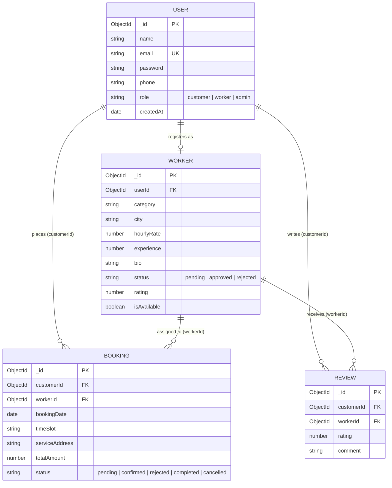

# ServeConnect — Hyper-Local Service Professional Marketplace

> **UCS503P — Software Engineering Project (2026-27 ODD)**  
> **Thapar Institute of Engineering and Technology, Patiala**  
> **Repository:** `UCS503P-2026-27-Local-Hands`

[]()
[]()
[]()
[]()

---

## 📖 Executive Summary

**ServeConnect** (Local Hands) is an on-demand, hyper-local service marketplace inspired by Urban Company. The platform seamlessly bridges the gap between everyday consumers and verified independent service professionals — including **Plumbers, Electricians, Carpenters, Painters, Cleaners, and AC Technicians**.

Engineered using the **MERN (MongoDB, Express.js, React.js, Node.js)** architecture, ServeConnect incorporates end-to-end user authentication, geo-location filtering, double-booking prevention, an administrative verification engine, automated transactional email dispatching, strict data isolation, and full compliance with **WCAG 2.2 AA accessibility** and **Technical SEO** standards.

---

## 👥 Project Team & Core Responsibilities

| Roll No. | Name | Primary Domain | Key Contributions |
| :--- | :--- | :--- | :--- |
| **1024170415** | **Vijay Kiran** | Backend & Database Engineering | REST APIs, MongoDB Schemas, Booking Data Isolation & Security Hardening, Double-Booking Prevention Engine, Database Seeding |
| **1024170233** | **Pratham Goyal** | Team Lead & Admin Architecture | Admin Verification Pipeline, Automated Notification Architecture (Nodemailer Email Service), Jest/Supertest E2E & Integration Suites |
| **1024170318** | **Keshav Goyal** | Frontend UI/UX & Client State | React.js SPA (Vite), Zomato-Style Location Context, Bookings Dashboard, WCAG 2.2 AA Compliance, Responsive Layouts |

---

## 🌟 Comprehensive Feature Catalog

### 1. 🔐 Authentication & Role-Based Access Control (RBAC)
- **Granular Roles:** Explicit privileges for `customer`, `worker`, and `admin`.
- **Stateless JWT Security:** Cryptographic token generation (`jsonwebtoken`) with `Bearer` header validation via backend middleware (`authMiddleware.js`).
- **Password Hashing:** Salted one-way hashing with `bcryptjs`.
- **Session Hygiene:** Registration workflows automatically flush legacy tokens and user states to eliminate cross-session data leakage.
- **One-Click Demo Authentication:** Pre-filled login helpers for rapid evaluation of Admin, Customer, and Professional roles.

### 2. 📍 Hyper-Local Discovery & Dynamic Location Context
- **Zomato-Style Global Location Selector:** Context-powered (`LocationContext`) location switching across primary metropolitan hubs (**Patiala, Delhi, Chandigarh, Ludhiana, Mohali**).
- **HTML5 Geolocation & Reverse Geocoding:** Live coordinates translated to human-readable cities via OpenStreetMap / Nominatim integration.
- **Service Filtering & Smart Ranking:** Filter by category, price tier, and real-time availability with rating-weighted ranking.

### 3. 🛡️ Professional Onboarding & Admin Verification Workflow
- **Multi-Step Worker Registration:** Technicians register category, experience, hourly rate, servicing radius, bio, and contact details.
- **Vetting Pipeline:** Profiles default to `pending` status and remain hidden from public search until reviewed.
- **Administrative Control Panel (`/admin`):** Real-time administrative dashboard to inspect, approve, or reject applicant profiles with one-click controls.

### 4. 📧 Automated Transactional Email System (Nodemailer)
- **Zero-Cost Production Ready:** Replaced legacy SMS (which required government DLT approvals in India) with a robust, automated Email Notification Service (`code/backend/utils/emailService.js`).
- **Branded HTML Email Templates:** On admin approval, the worker receives an immediate, beautifully styled confirmation email with direct dashboard access links.
- **Resilient Fallback Mode:** Operates in graceful simulation logging mode if SMTP credentials (`EMAIL_USER`, `EMAIL_PASS`) are omitted in development, guaranteeing zero-crash operation.

### 5. 📅 Double-Booking Prevention & Booking Lifecycle Engine
- **Concurrency Collision Detection:** Algorithmic verification prevents overlapping time-slot reservations for the same professional.
- **Full State Machine:** Bookings transition transparently across `pending` ➔ `confirmed` / `rejected` ➔ `completed` / `cancelled`.
- **Bidirectional Dashboards:** 
  - **Customers:** Track booking statuses, view professional details, and cancel pending requests.
  - **Workers:** Review incoming service requests, accept or reject jobs, and mark services as completed.

### 6. 🔒 Strict Booking Data Isolation & Security Hardening
- **JWT Identity Enforcement:** Booking creation strictly binds `customerId` to the cryptographically verified `req.user.id`, completely preventing client-side ID spoofing.
- **Disambiguated Dual-Role Querying:** In `getMyBookings`, customer queries (`customerId: userId`) are separated from technician queries (`workerId: worker._id`), ensuring users holding both roles never lose visibility into their bookings.
- **Authorization Guardrails:** `updateBookingStatus` prevents unauthorized users from altering the status of jobs they do not own or serve.
- **Reactive UI Lifecycle:** `Bookings.jsx` reacts immediately to `[token, user]` changes, eliminating stale state across user switch.

### 7. ♿ WCAG 2.2 AA Accessibility & Usability Optimization
- **Contrast Ratios (Criterion 1.4.3):**
  - Step 01 Badge: High-contrast Blue (`#1d4ed8`, 5.5:1 ratio).
  - Step 02 Badge: High-contrast Purple (`#7c3aed`, 5.8:1 ratio).
  - Step 03 Badge: High-contrast Forest Green (`#047857`, 4.7:1 ratio).
- **Semantic Document Outline:** Eliminated skipped heading levels (H2 ➔ H4); converted non-semantic headings to `<p className="footer-col-title">` enclosed within semantic `<nav>` landmarks.
- **Zoom Independence:** Removed viewport constraints (`maximum-scale=1.0, user-scalable=no`), ensuring low-vision users can zoom up to 500% freely.
- **Visual Artifact Fixes:** Resolved hero stats caret/cursor indexing issues by replacing inline borders with CSS pseudo-elements; removed redundant duplicate text rendering in cards.
- **Unified Copy:** Standardized all UI terminology from "Worker" to "Professional".

### 8. 🌐 Technical SEO & Indexing Architecture
- **Search Directives:** Custom `robots.txt` allowing public indexation while protecting private user areas (`/admin`, `/bookings`).
- **XML Sitemap:** Dynamic `sitemap.xml` listing core discovery endpoints.
- **Social Graph Metadata:** Integrated Open Graph (`og:image`, `og:title`, `og:description`) and Twitter Card tags in `index.html`.
- **Friendly 404 Routing:** Dedicated `NotFound.jsx` component catching unmapped routes with one-click return to home.

---

## 🏗️ System Architecture & Workflow

```mermaid
flowchart TD
    subgraph Client ["Client Layer (React.js + Vite)"]
        UI[User Interface]
        AuthCtx[Auth Context]
        LocCtx[Location Context]
    end

    subgraph Gateway ["API Layer (Express.js)"]
        AuthMW[Auth Middleware (JWT Verify)]
        RoleMW[Role Check (Customer/Worker/Admin)]
        Routes[API Endpoints]
    end

    subgraph Controllers ["Business Logic"]
        AuthCtrl[Auth Controller]
        WorkCtrl[Worker Controller]
        BookCtrl[Booking Controller]
        AdminCtrl[Admin Controller]
        EmailSvc[Nodemailer Email Service]
    end

    subgraph Storage ["Database (MongoDB Atlas / Mongoose)"]
        Users[(Users Collection)]
        Workers[(Workers Collection)]
        Bookings[(Bookings Collection)]
        Reviews[(Reviews Collection)]
    end

    UI --> AuthCtx & LocCtx
    UI -->|HTTP Requests with JWT| AuthMW
    AuthMW --> RoleMW
    RoleMW --> Routes
    Routes --> AuthCtrl & WorkCtrl & BookCtrl & AdminCtrl
    
    AdminCtrl -->|On Worker Approval| EmailSvc
    EmailSvc -->|SMTP / Simulation| SMTP[Worker Inbox]

    AuthCtrl --> Users
    WorkCtrl --> Workers
    BookCtrl --> Bookings & Workers
    AdminCtrl --> Workers & Users
```

---

## 🗄️ Database Schemas & Relations



---

## 🔌 API Endpoint Reference

### Authentication (`/api/auth`)
| Method | Endpoint | Access | Description |
| :--- | :--- | :--- | :--- |
| `POST` | `/api/auth/register` | Public | Register new user (`customer` or `worker`) |
| `POST` | `/api/auth/login` | Public | Authenticate and obtain JWT token |
| `GET` | `/api/auth/me` | Authenticated | Retrieve current authenticated user profile |

### Workers (`/api/workers`)
| Method | Endpoint | Access | Description |
| :--- | :--- | :--- | :--- |
| `GET` | `/api/workers` | Public | Search approved workers by category, city, and status |
| `GET` | `/api/workers/:id` | Public | Get detailed worker profile and reviews |
| `POST` | `/api/workers/register` | Worker | Register worker details (creates `pending` profile) |
| `PUT` | `/api/workers/availability` | Worker | Toggle worker availability status |

### Bookings (`/api/bookings`)
| Method | Endpoint | Access | Description |
| :--- | :--- | :--- | :--- |
| `POST` | `/api/bookings` | Customer | Create new booking (with double-booking check) |
| `GET` | `/api/bookings/my` | Authenticated | Fetch bookings for current customer or worker |
| `PUT` | `/api/bookings/:id/status`| Worker/Cust/Admin| Update status (`confirmed`, `rejected`, `completed`) |

### Administration (`/api/admin`)
| Method | Endpoint | Access | Description |
| :--- | :--- | :--- | :--- |
| `GET` | `/api/admin/workers/pending`| Admin | Retrieve list of all workers pending review |
| `PUT` | `/api/admin/workers/:id/approve`| Admin | Approve worker profile & trigger automatic email |
| `PUT` | `/api/admin/workers/:id/reject` | Admin | Reject worker application |
| `GET` | `/api/admin/stats` | Admin | Platform metrics (total users, bookings, revenue) |

---

## 📁 Repository Directory Structure

```text
UCS503P-2026-27-Local-Hands/
├── code/
│   ├── backend/                        # Express.js REST API Server
│   │   ├── config/                     # Database connection & env config
│   │   ├── controllers/                # Auth, Worker, Admin, Booking controllers
│   │   │   ├── adminController.js      # Worker approval & email trigger
│   │   │   ├── authController.js       # Register, login, token creation
│   │   │   ├── bookingController.js    # Data-isolated booking & collision engine
│   │   │   └── workerController.js     # Search, filter, profile management
│   │   ├── middleware/                 # Auth verification & role guards
│   │   ├── models/                     # Mongoose Schemas (User, Worker, Booking, Review)
│   │   ├── routes/                     # Express route declarations
│   │   ├── utils/                      # Helper utilities
│   │   │   └── emailService.js         # Nodemailer automatic email notification service
│   │   ├── tests/                      # Jest & Supertest integration suites
│   │   ├── createAdmin.js              # One-click admin generation script
│   │   ├── seed.js                     # 20 workers database seeding script
│   │   └── server.js                   # Application entry point
│   │
│   └── frontend/                       # React.js SPA (Vite)
│       ├── public/
│       │   ├── robots.txt              # Search engine crawling directives
│       │   └── sitemap.xml             # XML discovery sitemap
│       ├── src/
│       │   ├── components/             # Reusable UI (Navbar, Footer, ProtectedRoute)
│       │   ├── context/                # AuthContext & LocationContext
│       │   ├── pages/                  # Home, Search, Bookings, Login, Register, Admin, NotFound
│       │   ├── services/               # API client interfaces
│       │   ├── App.jsx                 # Route configurations
│       │   └── main.jsx                # Entry point & root render
│       └── index.html                  # Accessible viewport & SEO OpenGraph tags
│
├── docs/                               # Architecture blueprints & project specifications
│   ├── criteria-for-project-selection.md
│   ├── system-design.md
│   └── advanced-sprint-plan.md
│
├── journals/                           # Sprint journals (Weeks 1 through 6)
│   ├── Vijay_1024170415/
│   ├── Pratham_1024170233/
│   └── Keshav_1024170318/
│
└── README.md                           # Master Project Documentation
```

---

## 🚀 Quickstart & Setup Guide

### 1. Prerequisites
- **Node.js**: v18.0.0 or higher
- **MongoDB**: Local MongoDB instance or MongoDB Atlas connection URI
- **Git**

### 2. Backend Installation & Setup

```bash
# Navigate to backend directory
cd code/backend

# Install dependencies
npm install

# Configure Environment Variables (.env)
# Create a .env file with the following variables:
PORT=5000
MONGO_URI=mongodb+srv://<username>:<password>@cluster.mongodb.net/serveconnect?retryWrites=true&w=majority
JWT_SECRET=serveconnect_super_secret_jwt_key_2026
EMAIL_USER=your-email@gmail.com        # (Optional: fallback simulation active if omitted)
EMAIL_PASS=your-app-password           # (Optional)

# Seed Database with 20 Verified Professionals across 4 Cities
node seed.js

# Initialize Admin Account
node createAdmin.js

# Start Backend Server
npm start
```
*Backend runs on: `http://localhost:5000`*

### 3. Frontend Installation & Setup

```bash
# Navigate to frontend directory
cd code/frontend

# Install dependencies
npm install

# Start Vite Development Server
npm run dev
```
*Frontend runs on: `http://localhost:5173`*

---

## 🔑 Default Test Credentials

| Role | Email | Password | Intended Test Workflow |
| :--- | :--- | :--- | :--- |
| **Admin** | `admin@serveconnect.com` | `Admin@1234` | Access `/admin` dashboard to review pending workers and approve profiles (triggers automated approval email). |
| **Customer (Vijay)** | `vijayakiranyarra@gmail.com` | `123456` | Search professionals, book time slots, inspect isolated bookings status. |
| **Customer (Keshav)**| `keshav@example.com` | `123456` | Book a separate worker, verify data isolation on `/bookings`. |
| **Professional** | `rajesh.kumar@example.com` | `123456` | Log in as an approved Electrician, inspect incoming job requests, and accept/complete bookings. |

---

## 🧪 Automated Testing

Run the comprehensive Jest integration test suite:

```bash
cd code/backend
npm test
```

Test coverage includes:
- JWT authentication & credential verification
- Protected endpoint rejection on invalid or missing tokens
- Worker registration and admin approval state transitions
- Automated double-booking rejection on identical worker/time-slot combinations
- Booking ownership isolation verification

---

## 📜 Academic Integrity & Coursework Context

Developed for **UCS503P (Software Engineering Project)**, Department of Computer Science & Engineering, **Thapar Institute of Engineering and Technology (TIET)**, Patiala.
