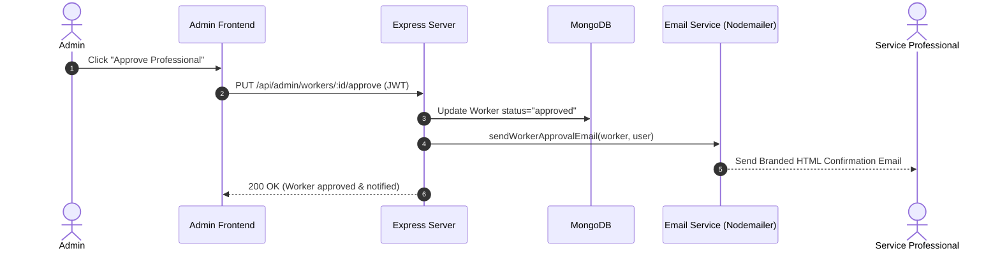

# ServeConnect: System Design & Architecture Specifications

> **UCS503P — Software Engineering Project (2026-27 ODD)**  
> **Thapar Institute of Engineering and Technology, Patiala**

---

## 1. Complete End-to-End Workflow

1. **Professional Registration:** Service professional registers with category, hourly rates, city, and bio. The profile status defaults to `pending`.
2. **Admin Verification & Automated Email Notification:** 
   - Admin inspects applicant credentials on `/admin`.
   - On approval, the backend triggers an automated branded HTML notification email via `Nodemailer` directly to the professional's registered email address, activating their profile.
3. **Customer Discovery & Booking:**
   - Customer selects location (via browser geolocation or manual picker) and filters by service category.
   - Customer chooses an available professional and selects a desired date and time slot.
   - **Double-Booking Validation:** The backend checks the professional's schedule and rejects conflicting reservations.
4. **Data-Isolated Booking Status:**
   - Customers track their active bookings in real-time under `/bookings`.
   - Technicians view incoming job requests, accept/reject, or mark them completed.
   - Both roles maintain strict data isolation enforced via verified JWT claims.
5. **Post-Service Review:** Customer leaves a 1–5 star rating and feedback to update the professional's public ranking.

---

## 2. Use-Case Diagram

```mermaid
usecaseDiagram
    actor Customer
    actor Professional as "Service Professional"
    actor Admin
    actor EmailService as "Automated Email Service"

    Customer --> (Search & Filter Professionals)
    Customer --> (Book Time Slot)
    Customer --> (Track Booking Status)
    Customer --> (Leave Rating & Review)

    Professional --> (Register Profile)
    Professional --> (Receive Approval Email)
    Professional --> (Manage Job Requests & Availability)

    Admin --> (Review Pending Applications)
    Admin --> (Approve / Reject Professional)
    (Approve / Reject Professional) --> EmailService
```

---

## 3. Data Isolation & Security Architecture

### 3.1 Identity Binding via JWT
- In booking creation, the authenticated identity (`req.user.id`) from verified JWT payload is strictly assigned to `customerId`. Client payloads cannot forge customer identities.
- Token refresh or logout automatically flushes cached authorization headers and client state.

### 3.2 Dual-Role Query Disambiguation
- When retrieving user bookings (`/api/bookings/my`), the query separates customer reservations (`customerId: userId`) from professional assignments (`workerId: worker._id`), preventing empty booking screens for dual-role users.

---

## 4. Automated Notification Subsystem



---

## 5. User Roles & Permission Matrix

| Operation | Customer | Professional | Administrator |
| :--- | :---: | :---: | :---: |
| Register & Authenticate | ✅ | ✅ | ✅ |
| Search Approved Professionals | ✅ | ✅ | ✅ |
| Create Service Booking | ✅ | ❌ | ❌ |
| View Own Bookings | ✅ (Customer Bookings) | ✅ (Assigned Jobs) | ✅ (All Platform Bookings) |
| Update Booking Status | ❌ (Cancel Only) | ✅ (Accept/Complete) | ✅ |
| Register Professional Profile | ❌ | ✅ | ❌ |
| Review Pending Professionals | ❌ | ❌ | ✅ |
| Approve / Reject Professionals| ❌ | ❌ | ✅ |

---

## 6. Comprehensive API Specifications

### Auth Endpoints (`/api/auth`)
- `POST /api/auth/register` — Public user registration (`customer` / `worker`).
- `POST /api/auth/login` — Public credentials authentication; returns JWT token.
- `GET /api/auth/me` — Authenticated profile verification.

### Professional Endpoints (`/api/workers`)
- `GET /api/workers` — Public discovery query (supports `city`, `category`, `search`).
- `GET /api/workers/:id` — Public profile & reviews fetch.
- `POST /api/workers/register` — Private (Worker role) profile creation.
- `PUT /api/workers/availability` — Private (Worker role) availability toggle.

### Booking Endpoints (`/api/bookings`)
- `POST /api/bookings` — Private (Customer role) booking creation with overlap prevention.
- `GET /api/bookings/my` — Private authenticated retrieval filtered by user ownership.
- `PUT /api/bookings/:id/status` — Private role-guarded booking state transition.

### Administration Endpoints (`/api/admin`)
- `GET /api/admin/workers/pending` — Private (Admin role) fetch pending applications.
- `PUT /api/admin/workers/:id/approve` — Private (Admin role) worker approval & email trigger.
- `PUT /api/admin/workers/:id/reject` — Private (Admin role) worker rejection.
- `GET /api/admin/stats` — Private (Admin role) overview metrics.
